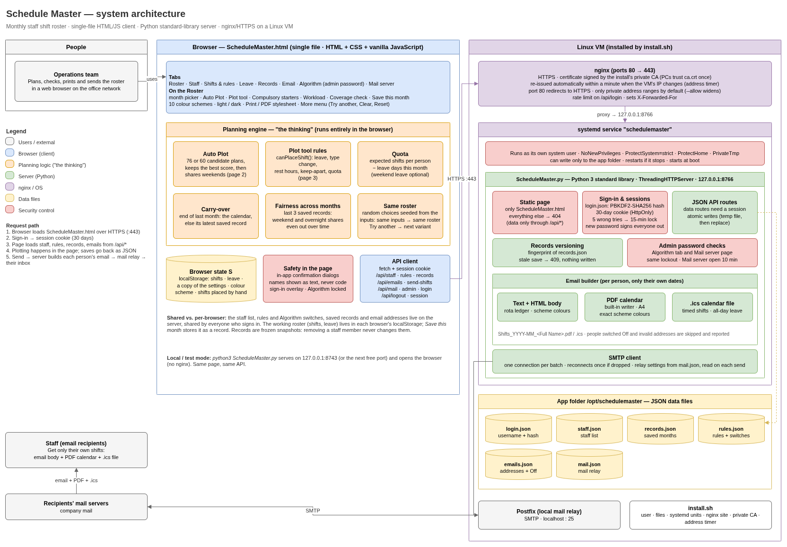
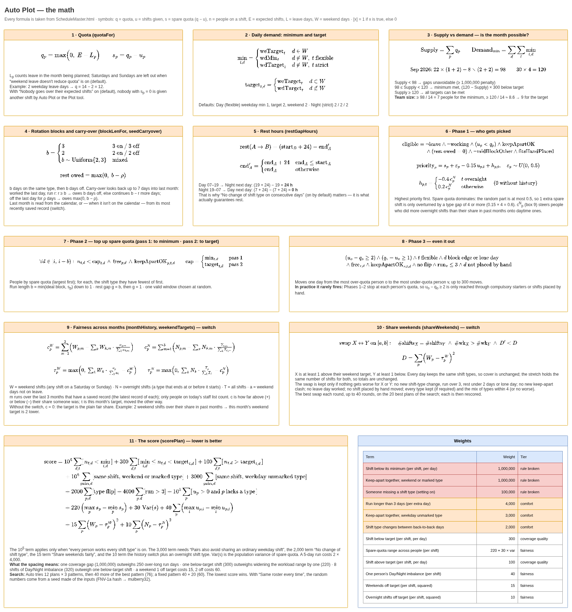
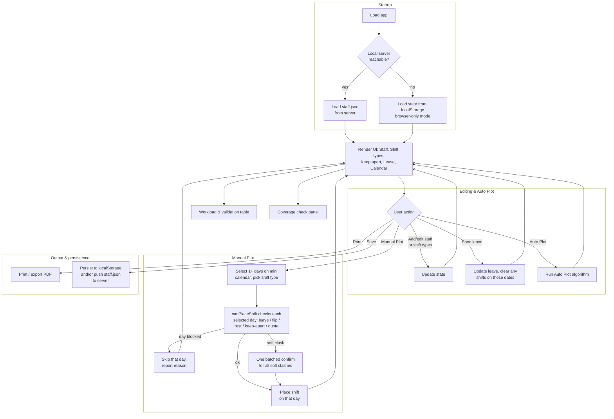
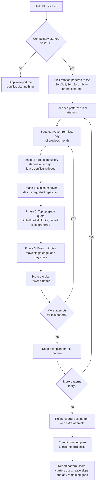
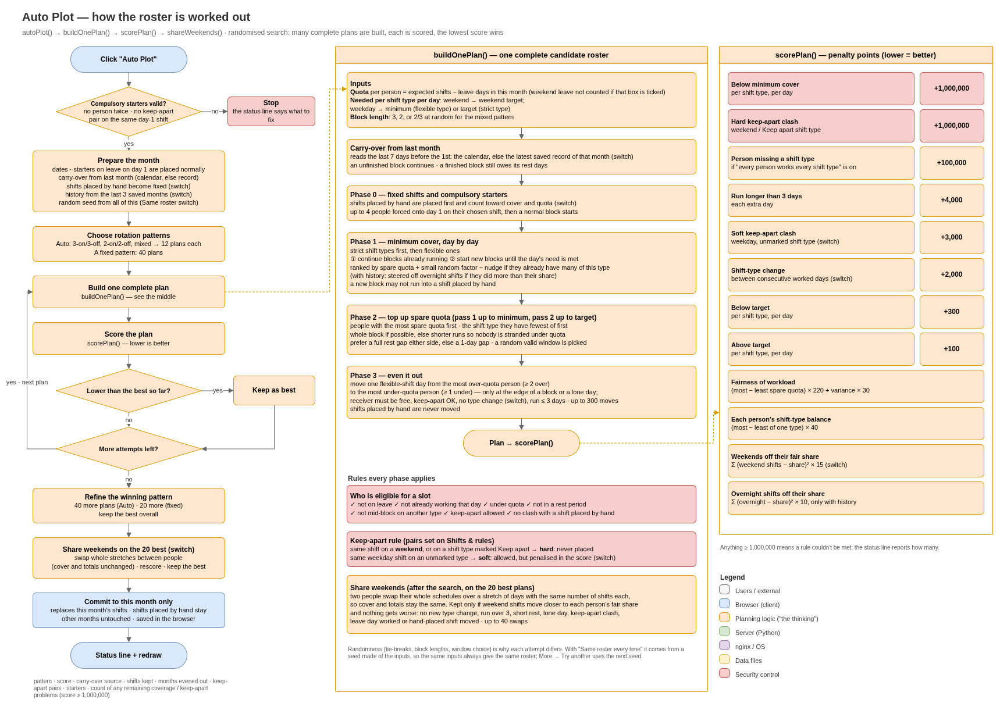
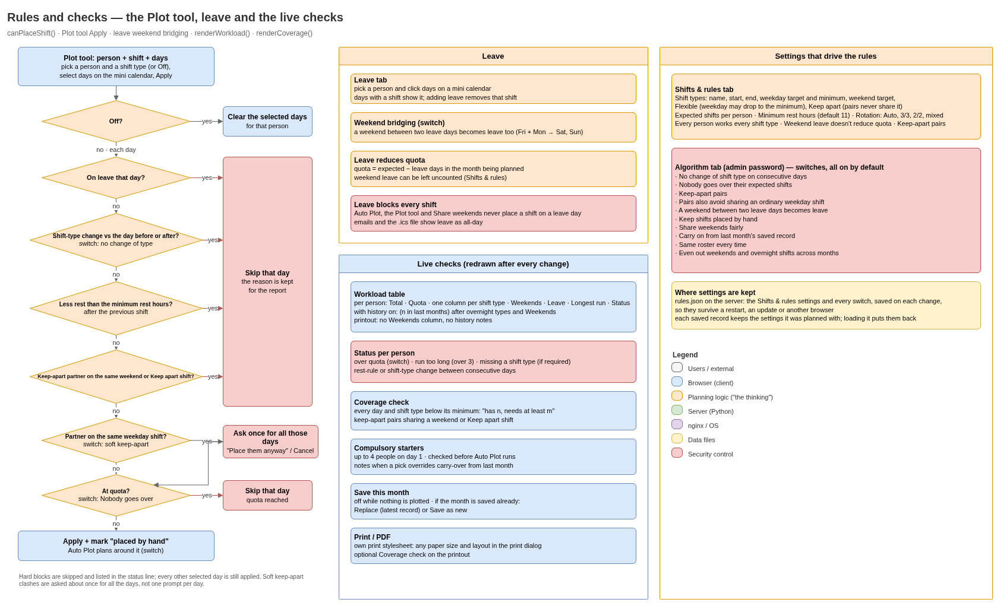
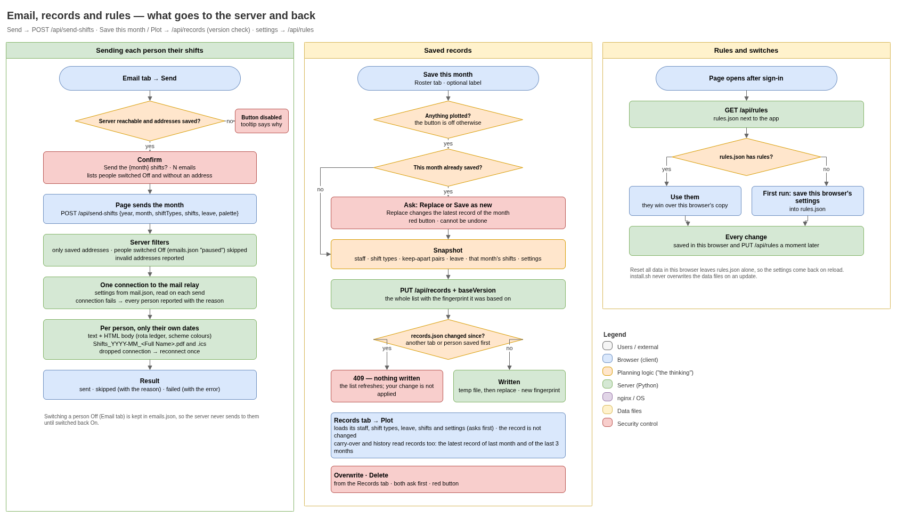

# Schedule Master

Schedule Master is a single-file HTML/JavaScript app for building and validating a monthly staff shift roster, paired with a small Python server (`ScheduleMaster.py`, standard library only — no packages to install) that adds a sign-in screen, shared `staff.json`/`records.json`/`emails.json` storage, and the ability to email each person their own shifts. It can be run two ways:

- **Personal / local use** — double-click or run `ScheduleMaster.py` on your own machine; it opens a browser tab pointed at itself. See *How to run* below.
- **Shared / production use** — deploy it on a small Linux VM with `install.sh`, which puts it behind nginx and https, running as a systemd service so the whole team can reach it. See *Deploying with install.sh* (§11) below.

Either way, the app itself always talks to the same `ScheduleMaster.py` server — there's no truly offline, server-less mode anymore (see *Login & access* below).


### Architecture at a glance



The diagrams in this README are PNG exports in [`docs/images/`](docs/images/), drawn in draw.io (one page per diagram). The editable draw.io file is kept outside the repository.

---

## How to run (personal / local use)

1. Make sure Python 3 is installed: `python3 --version`.
2. Open a terminal *in the folder* containing `ScheduleMaster.py`, `ScheduleMaster.html`, and `staff.json` (they all need to sit together).
3. Make the server script executable — you only need to do this once:
   ```
   chmod +x ScheduleMaster.py
   ```
4. Run it:
   ```
   ./ScheduleMaster.py
   ```
5. A terminal message confirms the server is running and a browser tab opens automatically at `http://127.0.0.1:8743/ScheduleMaster.html` (or the next free port, if 8743 is taken). A sign-in screen appears first (see *Login & access*) — the default is **admin / admin** until you set your own. Once signed in, staff, saved records, and saved email addresses are read from and written directly to `staff.json` / `records.json` / `emails.json` in that folder.
6. To stop the server, go back to the terminal and press `Ctrl+C`.

Next time, just repeat steps 4 and 5 — step 3 only needs doing once per copy of the files.

**Windows note:** `chmod`/`./` are Unix-only. On Windows, run `python ScheduleMaster.py` instead (or double-click the file if `.py` files are associated with Python) — everything else above is the same.

**Don't open `ScheduleMaster.html` directly** (double-clicking it, or dragging it into a browser) — the page only works when loaded *from* the server's own address (`http://127.0.0.1:...`), not opened as a local `file://` page: without the server behind it there's nothing to sign in against. Always start from the terminal as above.

---

## Login & access

Every visit starts at a sign-in screen; there's no way to reach the app without it.

- **Default credentials** are `admin` / `admin` until you create `login.json` next to `ScheduleMaster.py`:
  ```json
  { "username": "admin", "password": "your new password" }
  ```
  No restart needed: the next sign-in (or the next start of the server) picks it up and **replaces the plain password with a salted hash** (`"password_hash"`, PBKDF2-SHA256), so the password never stays on disk as plain text. Everyone is signed out when that happens. To change the password again, add a `"password"` line the same way. If the file can't be written (permissions), the server says so in its log and keeps checking the plain password.
- The same **admin password** opens the **Mail server** page (see §10).
- **Sessions** last 30 days (a cookie in the browser), so you're not asked again on every visit.
- **Lockout**: 5 wrong attempts in a row from the same address locks it out for 15 minutes.
- Signing out (the **Log out** button) clears the session immediately.
- This gate covers the whole app and every `/api/*` route except `/api/ping` and `/api/session` themselves (which is how the page knows whether to show the sign-in screen in the first place).
- The server serves exactly one static file, `ScheduleMaster.html`. Everything else in its folder — `login.json`, `staff.json`, `records.json`, `emails.json`, the script itself — returns 404 when requested directly; that data is only reachable through the signed-in `/api/*` routes. (Earlier versions served any file in the folder without a session, including `login.json`: if you ran one of those somewhere others could reach, change the password.)

---

## 1. What it does

- Holds a **staff list**, a set of **shift types** (e.g. Day / Night) with weekday/weekend headcount rules, optional **keep-apart pairs**, and per-person **leave**.
- Can **Auto Plot** an entire month automatically, respecting all the coverage and rest rules below — optionally forced to open the month with up to 4 named **compulsory starters** (see §9).
- Supports **Manual Plot** for one person across one or more days at a time, picked from a small click-to-select calendar, with the same rules enforced live.
- Shows a live **calendar**, a **workload & validation** table, and a **coverage check** panel.
- **Prints** a clean roster (and optionally the coverage check) to PDF/paper, laid out like a rota ledger (see §7).
- Lets you **save a labeled snapshot** of the current month — staff, shift types, keep-apart pairs, leave, that month's shifts, and settings — as a standalone record you can look back on or delete later, kept separate from the live data (see §8).
- Lets you pick one of **10 calendar color schemes** (on the *Shifts & rules* page) — purely cosmetic, but it's what colors the on-screen calendar, the printed page, *and* the email and its PDF (see *Color schemes* and §10).
- Can **email each person their own shifts** for the month — nobody sees anyone else's — with a PDF and an importable calendar (`.ics`) file attached (see §10).
- Has a **Mail server** page, behind the admin password, for the relay settings and a test email (see §10).
- Sits behind a **sign-in screen** (see *Login & access*) once `ScheduleMaster.py` is running.
- Persists staff, records, saved email addresses, mail settings and login credentials to `staff.json` / `records.json` / `rules.json` / `emails.json` / `mail.json` / `login.json` on the server; the current month's shifts and leave live only in the browser's `localStorage` (see §6).

### Finding your way around

- **Top bar**: the month (‹ › arrows, or click it to pick a month and year; the app always opens on next month, the one being planned; a saved month is a click away under Records), **Auto Plot**, a **More** menu (Print / PDF, the two printout options, Clear this month, Reset all data in this browser), a light/dark switch, **Mail server** and **Log out**.
- **Tabs**: **Roster** (the calendar, a side panel with **Plot**, **Leave** and **Starters** tabs, and the Workload table with the coverage check), **Staff** (the list, Save / Reload, Export / Import `staff.json`), **Shifts & rules** (shift types, expected shifts, rest, rotation, keep-apart pairs, calendar colours), **Records** and **Email**. The page you're on is kept in the address (`#staff`, …) and comes back after a reload.
- **Light / dark**: follows the device until you use the switch; the choice is saved in this browser. Dark mode is screen-only.

---

## 2. Data model

Everything lives in a single in-memory state object, `S`, saved to `localStorage` on every change:

| Field | Meaning |
|---|---|
| `staff` | Array of staff names |
| `shiftTypes` | Array of `{id, name, start, end, wdTarget, wdMin, weTarget, flex, ka}` |
| `keepApart` | Pairs of names that should never share a shift |
| `leave` | `{ personName: ["YYYY-MM-DD", ...] }` |
| `shifts` | `{ "YYYY-MM-DD": { personName: shiftTypeId } }` |
| `palette` | Selected calendar color scheme id (default `"classic"`) — see *Color schemes* |
| `expShifts`, `restHrs`, `rotation`, `requireAll`, `weekendLeaveNoQuota` | Global planning settings |

### Shift type fields
- **Weekday target** — headcount Auto Plot aims for on a weekday.
- **Weekday min** — the lowest it may sag to on a weekday, only if **Flex** is on.
- **Weekend target** — headcount on a weekend; weekends are always strict, so this doubles as the weekend minimum.
- **Flex** — allows the weekday dip described above.
- **Keep Apart** — a keep-apart pair is blocked from sharing this shift even on a weekday (normally keep-apart only applies strictly on weekends).

---

## Color schemes

The **Calendar colours** cards on the *Shifts & rules* page switch between 10 color schemes: **Classic** (the default), **Ocean**, **Sunset**, **Forest**, **Berry**, **Slate**, **Deep**, **Deep Bold**, **Deep Emerald**, and **Deep Crimson**. The choice is purely cosmetic — it never affects rules or planning — and is saved per browser (in `S.palette`, `localStorage`), not shared between people.

- Whichever shift type sits at position 1, 4, 7… in the shift-types list gets the scheme's first color; position 2, 5, 8… gets the second; position 3, 6, 9… gets the third. Leave always gets the scheme's own dedicated color, separate from the three shift-type colors.
- **Everywhere — on screen, on the printout (§7), in the shift email and its PDF (§10)** — all 10 schemes keep their own colors: whichever scheme is active is exactly what you see, print and send, pastel schemes included.
- **Dark mode is screen-only.** In dark mode (the device setting, or the switch in the top bar) the calendar uses darker backgrounds on screen, but printing always uses the light version of the chosen scheme on a light page, so a printout never comes out as a near-black sheet.
- **Pale schemes on paper:** the six pastel schemes (Classic/Ocean/Sunset/Forest/Berry/Slate) print in their soft on-screen tones with a coloured left edge on each chip so it stays distinct; if the printer is weak or prints greyscale, one of the four "deep" schemes (solid chips) gives stronger contrast.

---

## 3. Rules the system enforces

1. **Minimum cover** — every shift type must meet its minimum headcount (weekday-min-if-flex, or target-if-not-flex; weekend target) every day.
2. **No 24-hour flip** — a person can't work a Day shift then a Night shift (or vice versa) on adjacent days; once on a shift type, they stay on it until their block ends.
3. **Minimum rest** — the gap between the end of one shift and the start of the next (for the same person) must be at least `restHrs` hours.
4. **Run length** — nobody works more than 3 consecutive calendar days on a shift type before a break (used both as a soft rotation pattern and a hard penalty).
5. **Keep-apart pairs** — never share a shift on a weekend, or on any shift flagged Keep Apart; sharing an ordinary weekday shift is allowed but flagged, and Manual Plot asks for confirmation.
6. **Quota** — each person's total shifts for the month should not exceed `expShifts` minus their leave days that month (weekend leave days are excluded from the deduction if "Weekend leave doesn't reduce expected shifts" is on).
7. **Shift-type variety** — if "Every person needs every shift type" is on, someone who worked at all that month should get at least one of each shift type, not just one.
8. **Leave blocks shifts** — a person on leave can never be placed that day; saving leave immediately clears any shift already on those dates.
9. **Weekend leave auto-fill** — if leave spans a weekend (leave directly either side of Saturday/Sunday — e.g. Friday + Monday, or Friday + Sunday), the weekend day(s) in between are automatically added as leave too.
   Only a gap made up entirely of weekend days is filled; two leave dates further apart (say the 1st and the 28th) leave the weekends between them alone. (Earlier versions filled every weekend between any two leave dates — leave saved with those versions may contain extra weekend days; review it in the Leave tab.)
10. **Compulsory starters** — up to 4 named people can be forced onto a chosen shift on day 1 of the month; Auto Plot seeds them in before minimum cover runs, so they count toward it automatically, then they're treated as ordinary people for the rest of the month (see §9).
11. **Shifts placed by hand are kept** — anything placed with the Plot tool is outlined on the calendar, and Auto Plot plans around it. **More → Auto Plot from scratch** lets it move those too.
12. **Weekends shared fairly** — Saturday and Sunday shifts are spread by the weekend days each person is available. Workload shows a **Weekends** column.
13. **Fair across months** — weekends and overnight shift types (ending at or before they start) are evened out using the last 3 months of saved records (the latest record of each month). Workload shows the past counts beside this month's.

### Algorithm tab (rule switches)
The **Algorithm** tab, behind the admin password, turns rules 2, 5, 6, 9, 11, 12 and 13 on or off (rule 5 has two switches: keep-apart pairs at all, and the ordinary-weekday part). It also has **Carry on from last month's saved record**: when last month isn't on the calendar, Auto Plot continues people's blocks and rest from that month's most recently saved record (off: only the calendar counts). And **Same roster every time**: Auto Plot gives the same roster for the same staff, leave and settings, and **More › Try another** shows alternatives (off: every run is different, and Try another is hidden). Everything is on by default. It locks again when you leave the tab, and a reload never lands on it. The switches are saved in the browser with the rest of the planner and inside each saved record.

---

## 4. The Auto Plot algorithm

Auto Plot's job: produce one full month's roster that satisfies the hard rules above and is as *fair* and *evenly rotated* as possible. It does this by **generating several candidate plans and scoring them**, rather than solving it as a single deterministic pass — the search space (who works what, when) is too large to solve exactly, so it uses a randomized construction + scoring + refinement approach (a form of stochastic local search).

### Step-by-step

1. **Pick rotation patterns to try.**
   - If rotation is "Auto": try `3 on/3 off`, `2 on/2 off`, and a `mix` of both (random per block).
   - If a pattern is fixed by the user, only that one is tried.

2. **Seed carryover from last month.** For every person, look at the last day of the *previous* month to see if they were mid-block or mid-rest, so a block that started in the last few days of last month correctly continues (or a rest period correctly continues) into this month.

3. **Build one candidate plan** (`buildOnePlan`), in four phases:
   - **Phase 0 — Compulsory starters.** Anyone set in §9 (and not on leave day 1) is force-placed on their chosen shift on day 1, then seeded a normal rotation-length block from there — the same mechanism used to continue a carried-over run. This runs before Phase 1, so they count toward day 1's minimum cover automatically.
   - **Phase 1 — Minimum cover.** Walk the month day by day. Strict (non-flex) shift types are filled before flexible ones. For each shift type each day:
     - First, let anyone already mid-block (including a Phase 0 compulsory starter) continue their run.
     - Then pick more people from those who are free, under quota, resting-eligible, and keep-apart-safe — preferring whoever has the most spare quota (with a small randomized tie-break, and a slight bias toward whichever shift type they've had less of so far) — until the day's minimum is met.
   - **Phase 2 — Top up spare quota.** For anyone still under their personal quota, try to place additional full rotation-length blocks (preferring a slot with a full rest gap on both sides, falling back to a 1-day gap only if nothing fully-rested exists), shrinking the block size if a person's remaining quota is smaller than one full block.
   - **Phase 3 — Even things out.** Repeatedly find whoever is most *over* their fair share and whoever has the most *room*, and move a single flexible-shift day between them — but only at the edge of a block or a lone day, never splitting a block in half, and only if it doesn't break rest, keep-apart, or run-length rules.

4. **Score the plan** (`scorePlan`) — lower is better. Heavy penalties for:
   - Any day/shift under its **minimum** (very large penalty — this should basically never happen if staffing is adequate).
   - Under **target** but above minimum (medium penalty).
   - Over target (small penalty, discourages needless over-staffing).
   - A hard keep-apart clash (weekend, or a Keep Apart–flagged shift).
   - A soft keep-apart clash on an ordinary weekday (smaller penalty).
   - A run longer than 3 consecutive days, or a shift-type flip between two consecutive worked days.
   - Missing a required shift type for someone who worked that month (if "every person needs every shift type" is on).
   - **Unevenness**: the spread (max − min) and variance of "quota left unused" across staff — this is weighted heavily so the optimizer actively favors an even spread of total shifts.
   - A secondary, smaller penalty for an uneven personal split between shift types (e.g. mostly Day vs mostly Night) — a tie-breaker under the total-quota fairness above.
   - Weekend shifts away from each person's fair share (weighted below the spread of totals), and, with saved history, overnight shifts away from each person's share after what they did in past months.

5. **Repeat and pick the best.** For each rotation pattern, build several candidate plans (attempts) and keep the lowest-scoring one. Compare the best of each pattern, then run more attempts on the overall best pattern to refine it further.

6. **Share weekends.** On the 20 best plans, two people may swap their whole schedules over a stretch of days when that brings weekend shifts closer to each person's fair share. Every day keeps the same cover, both keep the same total, and the swap is only kept if nothing gets worse for either of them (no new flip, long run, short rest, keep-apart clash, leave conflict or moved hand-placed shift). The best plan after this wins.

7. **Commit.** The winning plan replaces the month's shifts. The status line reports the pattern used, its score, and how many minimum-coverage/keep-apart issues (if any) remain unresolved — a non-zero count means staffing is too tight to fully satisfy every rule.

### Manual Plot
Manual Plot (the **Plot** tab beside the calendar) places one person on one or more days at once. Pick a person, click days on the mini calendar to select them (days on leave are grayed out and can't be selected; days that already have a shift show it as a small colored tag), choose a shift type (or "Off" to clear), then apply.

Each selected day runs the same live checks Auto Plot's scoring penalizes for: leave conflicts, shift-type flip vs. the day before/after, minimum rest, keep-apart, and quota — so a manual placement never silently breaks a rule Auto Plot would have avoided:
- **Hard blocks** (leave, a shift-type flip, insufficient rest, a hard keep-apart clash, or being over quota) are skipped for that day and listed in the status message; every other selected day is still applied.
- **Soft keep-apart clashes** (sharing an ordinary weekday shift with a keep-apart partner) are batched into a single confirmation dialog covering all affected days, rather than one prompt per day.
- "Select all" selects every day in the month that isn't a leave day for the chosen person; "Clear" deselects everything. The selection is also cleared automatically after applying, or when you switch person, month, or year.


### The math behind it

Every formula Auto Plot uses — quota, daily minimum and target, rest, carry-over, fairness across months, the Phase 1 ranking, the Phase 2/3 conditions, the weekend swap and the full score with its weights — is on one page, typeset (draw.io page 5):



---

## 5. Flow diagram

### Overall app flow

The diagram below picks up *after* the sign-in screen (see *Login & access*) — since that screen itself needs the server to check your session against, the "no" branch below is now mostly a leftover safety net for a server hiccup mid-session rather than a real day-to-day path.



### Auto Plot algorithm




### Detailed diagrams (draw.io)

The Mermaid charts above give the overview; the draw.io pages go one level deeper.

**Auto Plot logic** — the search loop, what one candidate plan goes through (inputs, carry-over from the calendar or a saved record, shifts placed by hand, Phases 0–3, eligibility and keep-apart rules), Share weekends and the scoring table:



**Rules and checks** — the decision chain the Plot tool runs before placing each shift, the leave rules, the live checks, and the settings and Algorithm switches that drive them:



**Email, records and rules flows** — sending shifts (including people switched Off and invalid addresses), Save this month with Replace or Save as new, how a save from an out-of-date page is refused instead of overwriting newer records, and how rules.json is loaded and saved:



---

## 6. Persistence & data flow

Signing in requires `ScheduleMaster.py` to be running (see *Login & access*), so in practice there's no longer a fully offline, server-less mode — but not everything lives on the server:

- **Server-backed** (shared across everyone who signs in, read/written straight to disk next to `ScheduleMaster.py`): `staff.json` (`GET`/`PUT api/staff`), `records.json` (`GET`/`PUT api/records`, §8), `rules.json` (`GET`/`PUT api/rules`: the Shifts & rules settings and the Algorithm switches, saved on every change so they survive a restart, an update or another browser; created from the first browser that opens the app), `emails.json` (`GET`/`PUT api/emails`, §10), and `login.json` (credentials only, §*Login & access*).
- **Browser-only** (this device/browser only, never sent to the server except when you explicitly send shifts by email): the current month's `shifts`, `leave`, a copy of the planning settings (`rules.json` wins when the page loads), and the selected color `palette` — saved to `localStorage` under the key `schedulemaster_state` (auto-migrated once from the old key `planthat_state` if found).
- **Confirmations** use the app's own dialog (not the browser's pop-up) for: deleting, loading (Plot) or overwriting a saved record; sending emails; clearing the month; resetting local data; removing all of a person's leave; placing a shift despite a soft keep-apart clash; reloading with unsaved staff changes; removing a staff member; removing a saved email address; and removing a shift by clicking it on the calendar. Actions that can't be undone have a red button and start with Cancel selected, so pressing Enter by accident cancels. Esc or clicking outside the dialog also cancels.
- **Staff edits** (add, remove, import) change the list in this browser straight away but only reach `staff.json` when you click **Save** on the Staff page; the status line says so after each edit. **Reload** — and the next page load — replace the list with the server's copy, so Reload now asks first if there are unsaved staff edits.
- **Reset all data in this browser** (More menu) wipes shifts, leave, and settings from *this browser only* — it does not touch `staff.json`, `records.json`, `rules.json`, `emails.json`, `mail.json` or `login.json` on disk.

---

## 7. Printing

**More › Print / PDF** prints the Roster page as a rota ledger (choose the paper size and layout in the print dialog; it fits portrait or landscape): the month in serif with "Duty roster" under it and "Schedule Master" on the right, a heavy rule, then one ruled line per week with the ISO week number in the margin (weeks run Monday to Sunday), weekends shaded, and each person's shift as a tinted chip. The Workload table (and, if ticked, the coverage check) follows on its own page.

- **One page per month**: the row height comes from the page height and the number of weeks, so 4, 5 and 6-week months all fill one page. The calendar only shrinks (via CSS `zoom`, never below 55%) when a day holds more shifts than a row can show.
- **Printout options** (More menu): *Coverage counts on each day* (the `Day 2/2` line) and *Coverage check*.
- Every color scheme prints in its own colors, the light-mode version even when the screen is in dark mode (see *Color schemes* above).
- Only the Roster page is printed — never the Staff, Records, Email or Mail server pages, or the Plot / Leave / Starters panel.

---

## 8. Saved records

The **Records** page lets you keep a permanent, labeled history of past rosters — entirely separate from the live `S` state everything else in the app reads and writes. Saving, viewing, and deleting a record never changes what's currently plotted, and plotting or editing the live roster never changes a saved record.

- **Save**: on the Roster, beside the month title, typing a label (optional — it defaults to "Month Year") and clicking "Save this month" takes a full snapshot of that month — staff, shift types, keep-apart pairs, leave, that month's shifts, and the global settings (expected shifts, min rest, rotation, and the two checkboxes) — and adds it to the saved list. If that month is already saved, it asks first: **Replace** the latest record of that month, **Save as new**, or Cancel.
- **View**: each record shows a one-line summary (staff/shift-type/placed-shift counts) plus a "View" button that expands the complete saved snapshot as raw JSON, so you can always refer back to exactly what was saved.
- **Load (Plot)**: puts a record back on the calendar exactly as it was saved — its staff list, shift types, keep-apart pairs, settings, and that month's shifts and leave — so you can look at an old roster at any time. Leave in every *other* month is left as it is now. The record itself is never changed by loading it.
- **Staff who have since left**: removing someone from the staff list never touches saved records, so loading an old record still shows that person's shifts and leave for that month, and lists them for that view; the status line names anyone who isn't on your current staff list. While a record's staff list is on screen, **Reload** takes you back to your current list, and **Save** asks first — naming who would be added back to or removed from `staff.json` — before writing the record's list there.
- **Two tabs or two people at once**: records are saved as a whole list, so each save carries a fingerprint of the list it started from. If the saved records changed in the meantime (another tab, or someone else), the server refuses the save instead of overwriting, the page switches to the latest list and says your change wasn't applied, and you simply do it again. Older cached copies of the page still save as before.
- **Delete**: each record has its own "Delete" button (with a confirmation prompt); deleting one only removes that record.
- **Storage**: records live in their own file, `records.json`, kept apart from `staff.json`, read from and written to it directly (`GET`/`PUT api/records`) since signing in requires the server to be reachable in the first place (see §6). If the server can't be reached after signing in, they fall back to `localStorage` under `schedulemaster_records` (auto-migrated once from the old key `planthat_records` if found), with "Export records.json" / "Import records.json" buttons to move them to/from a file by hand, mirroring how staff are exported/imported.

---

## 9. Compulsory starters

The **Starters** tab (beside the calendar on the Roster page) lets you name up to 4 people who must already be working a chosen shift on **day 1** of the month, before Auto Plot runs — useful when you know a specific opening lineup is required regardless of what Auto Plot would otherwise pick.

- **Scope: one-off, not a standing rule.** The slots apply only to the month shown when you set them. Switching month or year (the month switcher in the top bar) clears all 4 slots back to empty — they do **not** carry forward to the next month automatically.
- **Setting it up**: each of the up to 4 slots is a person + a shift type. Leaving a slot's person or shift empty just means that slot isn't active yet.
- **Validation, live in the tab**:
  - The same person picked in two slots → blocked (duplicate), shown as a warning under the slots.
  - Two people who are a keep-apart pair, both set to start on the *same* shift → blocked, same as anywhere else a keep-apart clash would happen.
  - These two are hard errors: Auto Plot refuses to run at all until they're fixed, and the tab tells you exactly what to change.
- **Leave on day 1**: not a hard error. If a compulsory starter is on leave on the 1st, Auto Plot skips forcing that person for day 1 and places them normally instead (leave always blocks a placement, for anyone) — and says so afterwards in the status line, e.g. *"X was on leave on the 1st — placed normally instead of forced."*
- **How Auto Plot uses it**: this runs as a new **Phase 0**, before minimum cover (see §4) — each active compulsory starter is force-placed on their chosen shift on day 1, then seeded a normal rotation-length block from there, so they count toward day 1's minimum headcount automatically rather than needing a separate carve-out. After day 1, they're treated as an ordinary person: quota, rest, keep-apart, and the fairness balancing in Phase 3 all still apply to them normally.
- **Carryover overrides**: if forcing someone onto day 1 would normally have meant more rest, or continuing a different shift type from the end of last month, the compulsory-starter rule wins — they're placed as requested — but the status line notes the override, e.g. *"X was mid-block on Night — starting them on Day instead overrides that."*

---

## 10. Sending shifts by email

The **Email** page lets you save one address per person and, with one click, send everyone their own dates and shift times for the month currently shown — nobody sees anyone else's schedule.

- **Saved addresses** live in `emails.json` on the server (`GET`/`PUT api/emails`), separate from `staff.json` and `records.json`. Saving and sending both require `ScheduleMaster.py` to be running — the page disables the Send button (with an explanatory tooltip) if it can't reach the server.
- **On/Off per person** — each saved address has an **On/Off** button. Turning someone **Off** keeps their address but leaves them out when you send to everyone; the list shows how many will be emailed, the confirmation names who is turned off, and the result lists them as skipped ("sending turned off"). The setting is saved in `emails.json` as an optional `"paused": [names]` list (the key only appears while someone is turned off), so it's shared by everyone who signs in, and the server enforces it when sending. Deleting a person's address also clears their Off setting.
- **Send shifts to everyone** asks for confirmation (naming how many emails will go out and which color scheme they'll be colored with), then sends one individual email per saved address through the SMTP relay set on the **Mail server** page / in `mail.json` (see *Mail relay settings* below — without it, a local Postfix relay on the same machine, no login required).
- **Each email contains three things:**
  1. The message itself, laid out as a **rota ledger**: the month in serif with "rota for *name*", one ruled line per week with the ISO week number in the margin, each working day marked with its shift's letter in the active scheme's colors (see *Color schemes*), days off as a faint dot, and the totals per shift type (with their hours) and leave at the foot. Marks are the shift type's first letter (`D`, `N`, or `M` / `A` / `E`); when two types start with the same letter, or one starts with `L` (which means leave), they get two letters instead (`Da`, `Du`, `La`). It's built from tables with inline styles so it shows properly in Outlook and Gmail, and comes with a plain-text version for mail apps that don't show formatted email.
  2. A one-page **PDF** of the same rota ledger on landscape A4 — each working day shows the shift's name and hours — with the totals at the foot, colored using whichever calendar scheme was active in the browser when you clicked Send.
  3. A **calendar file (`.ics`)** the recipient can import into their phone or calendar app — one event per shift (correctly spanning midnight for overnight shifts like the default Night shift) plus an all-day event for each day of leave.
     Times are "floating" local times — the same wall-clock hours shown in the app — so they land at those hours on the recipient's calendar whatever its time zone setting. Each event's ID is fixed per person + date, so importing a re-sent month updates that day's event instead of adding a duplicate (most calendar apps; a few simply re-import). A shift type whose start/end time can't be read is added as an all-day event rather than failing the send.
- **Both attachments are named after the recipient**, not a generic filename — `Shifts_YYYY-MM_Full Name.pdf` / `.ics` (e.g. `Shifts_2026-09_Ama Mensah.pdf`).
- **After sending**, the page reports how many emails were sent, and lists anyone **skipped** (no valid-looking email address on file) or **failed** (the relay rejected or couldn't be reached), each with a reason.
- The PDF is generated with a small dependency-free writer built into `ScheduleMaster.py` itself — no `reportlab` or other third-party package required, consistent with the rest of the app.

### Mail server page

The **Mail server** button in the top bar asks for the admin password (the sign-in password; wrong guesses count toward the same 5-attempt lockout), then swaps the app for one page with the relay settings: SMTP server, security (**None**, **STARTTLS** or **SSL/TLS**), port (filled in as 25 / 587 / 465 when you change security, unless you typed your own), username, password, From address and From name.

- **Save** writes them to `mail.json` (see below), keeping any `_note` keys you added by hand. The saved password is never shown or sent back to the page — leave the box blank to keep it, or tick *Remove the saved password*.
- **Send test** sends one email to an address you type, through the saved settings, and shows the relay's own error if it fails.
- The page stays open for this sign-in for 10 minutes after the password or the last save; **Back to planner** closes it and locks it again. While it's open, the tabs and other controls are hidden.

### Mail relay settings (`mail.json`)

The Mail server page writes `mail.json` next to `ScheduleMaster.py` (on an installed VM: `/opt/schedulemaster/mail.json`); you can also edit it by hand:

```json
{ "host": "smtp.example.com", "port": 587, "from_name": "Schedule Master", "from_addr": "rota@example.com",
  "username": "rota", "password": "secret", "security": "starttls" }
```

- Every key is optional — anything left out keeps the default from the `SMTP_*` lines at the top of `ScheduleMaster.py` (`127.0.0.1:25`, from `scheduler@localhost`, no login, no TLS). No `mail.json` at all means exactly those defaults. `security` is `"none"`, `"starttls"` or `"ssl"` (SSL/TLS from the first byte, usually port 465); older files with `"use_tls": true` / `false` still work and mean STARTTLS / none. `username` + `password` turn on login. Keys starting with `_` are ignored, so you can leave notes.
- It's read fresh on every send — **no restart needed** after editing it.
- `install.sh` **never overwrites it** (like `staff.json`/`records.json`/`emails.json`/`login.json`) and keeps it readable by the app's own user only, since it can hold the relay password. Like the other data files, it's never served over the web.
- If it can't be used (broken JSON, a misspelled key such as `"pasword"`, a port that isn't a number), **nothing is sent** and the Email page shows why — it never quietly falls back to a different relay. The server also prints the relay it will use (and any problem with `mail.json`) when it starts.
- Editing the `SMTP_*` lines in `ScheduleMaster.py` still works, but an upgrade replaces that file, so `mail.json` is the place for your settings.

---

## 11. Deploying with install.sh (production / shared use)

For a team to share one always-on instance instead of everyone running it on their own laptop, `install.sh` sets Schedule Master up as a proper service on a Linux VM (Debian/Ubuntu or RHEL/Rocky/Alma/Fedora):

```
sudo bash install.sh                          # install/upgrade, https on this VM's own address(es)
sudo bash install.sh sched.lan 10.0.0.5        # also answer to these extra names/IPs (kept in the cert from then on)
sudo bash install.sh --new-ca sched2.lan       # add a name later (makes a new private CA - see below)
sudo bash install.sh --allow any               # let addresses outside your private network reach it too
sudo bash install.sh --allow 41.66.0.0/16      # or just allow one specific extra range
sudo bash install.sh --uninstall               # remove the service and nginx site (your data stays put)
```

What it sets up:

- The app in `/opt/schedulemaster`, run by systemd as its own unprivileged user — starts at boot, restarts if it ever stops.
- **nginx** in front of it on ports 80/443 (80 redirects to https); the app itself only listens on `127.0.0.1:8766` and is never reachable directly.
- **https from a private certificate authority (CA)** made on the VM at install time, plus a server certificate it signs for the VM's current address(es) — see *https and IP address changes* below. Until a PC trusts the CA its browser shows a trust warning; import `/etc/ssl/schedulemaster/ca.crt` once to make it go away for good.
- An **address refresher** (`schedulemaster-address.timer`, at boot and every minute) — when the VM's IP changes it issues a new certificate for the new address and reloads nginx, so you **don't need to re-run `install.sh`** after an IP change. nginx itself answers on whatever address the VM has (`server_name ~.;`).
- By default nginx only accepts connections from private/loopback addresses (RFC1918 + localhost); `--allow` widens that, and the choice is remembered on future re-runs.
- Extra brute-force protection at the nginx layer on `/api/login` (rate-limited), on top of the app's own 5-attempt lockout (see *Login & access*).

Re-running the installer to upgrade is safe — `staff.json`/`records.json`/`emails.json`/`login.json`/`mail.json` are never overwritten. It does replace `ScheduleMaster.py` with the new version, so mail settings belong in `mail.json` (see *Mail relay settings*), not in the `SMTP_*` lines of the code. **Upgrading an install whose `SMTP_*` lines were edited by hand:** if there's no `mail.json` yet, the installer reads those lines from the installed copy (without running it) before replacing it, writes the values that differ from the defaults into `mail.json`, and prints which settings it kept (never the password). If a value can't be read that way, it keeps the old file as `ScheduleMaster.py.before-upgrade` and tells you to copy the setting across by hand.

### https and IP address changes

Changing the VM's IP (a move, a new DHCP lease, a cloned VM) needs no re-install:

- **nginx** isn't tied to an address — it answers on any name/IP the VM is reached by. The private-address allow list still applies.
- **The certificate** is re-issued within a minute of the change by `/usr/local/sbin/schedulemaster-refresh-address` (run by `schedulemaster-address.timer`). It's signed by the same private CA, so a PC that trusts `ca.crt` keeps trusting it — no warning, nothing to re-import. The refresher also renews the certificate 30 days before it expires (they last 825 days), and does nothing at all when nothing changed. What it did is in `journalctl -u schedulemaster-address`.

**Trusting the CA on a PC** (once): copy `/etc/ssl/schedulemaster/ca.crt` to the PC and import it as a trusted root —
Windows: double-click › *Install Certificate* › *Local Machine* › *Place all certificates in the following store* › **Trusted Root Certification Authorities**;
macOS: open it in Keychain Access (System keychain) › *Trust* › **Always Trust**;
Firefox (own store): *Settings › Privacy & Security › View Certificates › Authorities › Import* (trust for websites).

**Why a CA is safe to trust here:** the CA carries *name constraints* — it can only ever vouch for private addresses (10.x, 172.16–31.x, 192.168.x, 127.x), `localhost`, and the names listed in `/etc/ssl/schedulemaster/ca-names.txt` (the names given to `install.sh`, the VM's hostname, and any public IP it had at install). Browsers reject anything else it signs, so even someone who copied `ca.key` couldn't use it to impersonate another website to your PCs. `ca.key` is readable by root only.

**Upgrading from an older install** (which used a self-signed `schedulemaster.crt`): the first run of the new `install.sh` creates the CA, keeps the names and public IPs the old certificate covered, and switches https over. PCs that had trusted the old `schedulemaster.crt` see a warning **once** — remove the old certificate from them and import `ca.crt` instead; after that, IP changes are invisible to them.

Things to know:

- **New private IPs are covered automatically; new public IPs are not.** A public (non-RFC1918) address the VM gets later is logged as "not covered" and served with the private-address certificate (browsers warn). Public IPs the VM had at install, or that you name on the `install.sh` command line when the CA is made, are covered.
- **Adding a name later** (e.g. a DNS name you create after installing) needs `sudo bash install.sh --new-ca the.new.name`. That makes a new CA (keeping every name the old one covered, plus the new one; the old CA is kept as `ca.*.replaced-<date>`), so each PC imports the new `ca.crt` once. A plain re-run with a name the current CA can't cover only warns and changes nothing. Private IPs can always be added without a new CA.
- The CA itself is valid for 10 years; `--new-ca` also renews it.
- Leaving `/etc/ssl/schedulemaster` alone across re-runs and upgrades is what keeps PCs trusting the VM — back it up along with `/opt/schedulemaster` if you rebuild the VM.

Useful commands once installed:

```
systemctl status schedulemaster        # is it running (it starts by itself at boot)
journalctl -u schedulemaster -f        # live log (logins, emails sent)
systemctl restart schedulemaster       # restart after replacing ScheduleMaster.py/.html by hand
journalctl -u schedulemaster-address   # IP changes seen / certificates re-issued
sudo /usr/local/sbin/schedulemaster-refresh-address   # re-check the address right now instead of waiting up to a minute
```
